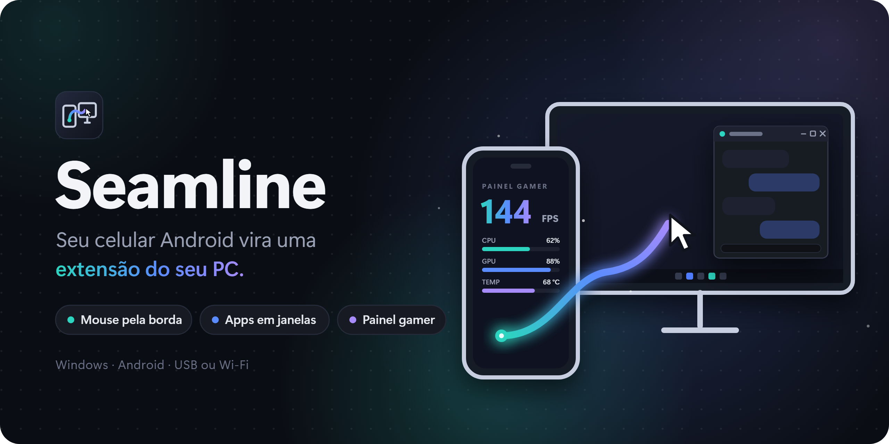
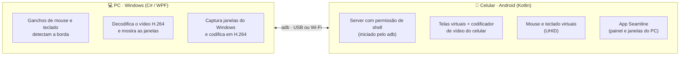

<div align="center">



<br>

Leve o mouse para fora da tela e ele aparece no celular. Puxe um app do celular e ele vira uma janela do Windows.


[](https://github.com/pixel444-dev/seamline/releases/latest)

</div>

---

## ✨ O que ele faz

<table>
<tr>
<td width="50%" valign="top">

### 🖱️ Mouse e teclado no celular
Passe o cursor pela borda da tela do PC e ele **some do Windows e aparece no celular**, com a setinha de verdade do Android. O teclado vai junto (inclusive acentos e Ç do ABNT2). Para voltar, é só levar o cursor de volta pela borda.

</td>
<td width="50%" valign="top">

### 📱 Apps do celular em janelas do PC
Mande qualquer app aberto no celular para o PC: ele vira uma **janela normal do Windows**, que dá para mover, redimensionar e trocar com Alt+Tab. O app continua rodando no celular; o PC só mostra a imagem e devolve os cliques.

</td>
</tr>
<tr>
<td width="50%" valign="top">

### 🖥️ Janelas do PC no celular
O caminho contrário: mande uma janela do Windows para a tela do celular e use-a com toques. O programa continua rodando no PC.

</td>
<td width="50%" valign="top">

### 🎮 Painel gamer
FPS, uso de CPU, GPU e RAM e temperaturas, num painel escuro **no PC e no celular**. Deixe o celular ao lado do monitor e acompanhe tudo sem sair do jogo. O celular recebe só os números, sem vídeo, então quase não pesa.

</td>
</tr>
<tr>
<td width="50%" valign="top">

### 🪞 Espelhamento da tela
Veja e controle a tela inteira do celular numa janela do PC: clique para tocar, botão direito para Voltar, rodinha para rolar.

</td>
<td width="50%" valign="top">

### 📶 Pareamento por QR code
Sem cabo: o PC mostra um QR code, você lê pela **Depuração sem fio** do Android e pronto. Também funciona por cabo USB ou com o código de 6 dígitos.

</td>
</tr>
</table>

### Gestos de arrastar
- **Do celular para o PC:** com o cursor no celular, segure o botão esquerdo e empurre para fora pela borda. O app da frente vem junto, já virando janela.
- **Do PC para o celular:** arraste uma janela e empurre o cursor contra a borda. Ela vai para o celular (ou, se for um app do celular, volta para lá).

---

## 🧩 Como funciona



Um app Android comum não pode controlar outros apps nem criar telas virtuais. Por isso o Seamline usa o mesmo caminho do [scrcpy](https://github.com/Genymobile/scrcpy): o PC envia um pequeno **server** pelo `adb` e o executa com permissão de "shell". É ele que:

- cria um **mouse e um teclado virtuais** (o Android acha que tem um mouse plugado e mostra a setinha);
- cria **telas virtuais** invisíveis, move os apps para elas e manda o vídeo de cada uma para o PC;
- injeta os toques e as teclas que chegam do PC.

O protocolo entre os dois lados (mensagens JSON + fluxos de vídeo) está descrito em [`docs/protocolo.md`](docs/protocolo.md).

---

## 📥 Baixar e usar (sem programar nada)

Na página de **[Releases](https://github.com/pixel444-dev/seamline/releases/latest)**, baixe o **`Seamline-Setup-<versão>.exe`** e instale. Ele já traz tudo o que precisa (o .NET e o `adb`): não é preciso instalar Android Studio nem mais nada. O app do celular é instalado sozinho pelo PC na primeira vez que ele for usado.

| No PC | No celular |
|---|---|
| Windows 10 versão 2004 ou mais novo, 64 bits (testado no Windows 11) | Android 11 ou mais novo; o mouse pela borda precisa do **Android 16** (testado nele) |
| | **Opções do desenvolvedor** ativadas (Configurações → Sobre o telefone → toque 7 vezes em *Número da versão*) |
| | **Depuração USB** ou **Depuração sem fio** ligada (dentro das Opções do desenvolvedor) |

Depois de instalar:
1. Abra o **Seamline** pelo menu Iniciar.
2. Ligue o celular no PC pelo cabo, ou clique em **Parear pelo Wi-Fi...** e leia o QR code em *Opções do desenvolvedor → Depuração sem fio → Parear dispositivo com código QR*.
3. Escolha o celular na lista e clique em **Conectar**.
4. Leve o mouse para a borda esquerda do monitor: ele passa para o celular. 🎉

Outras opções na mesma página: **`Seamline-<versão>-portatil.zip`** (sem instalar: descompacte e abra o `Seamline.exe`) e **`Seamline-<versão>-celular.apk`** (o app do celular avulso, caso queira instalar à mão).

> [!NOTE]
> Como o instalador ainda não tem assinatura digital, o Windows pode mostrar *"O Windows protegeu o computador"*. Clique em **Mais informações → Executar assim mesmo**. Pelo Wi-Fi, o PC e o celular precisam estar na mesma rede, e o Firewall do Windows pode perguntar se libera o `adb`: libere em redes privadas.

> [!NOTE]
> O **FPS** e a **temperatura da CPU** do painel gamer só funcionam com o Seamline aberto como administrador (o Windows exige). A temperatura da CPU também precisa do driver [PawnIO](https://pawnio.eu). O próprio painel tem um botão que reabre o app como administrador.

---

## 🚀 Como compilar e rodar (para quem quer mexer no código)

Precisa de: [.NET 10 SDK](https://dotnet.microsoft.com/download) e [Android Studio](https://developer.android.com/studio) (traz o JDK 21 e o `adb`).

A ordem importa: o programa do PC leva junto os APKs do Android.

**1. Android** (use o JDK 21 que vem com o Android Studio, não um Java mais novo):

```bash
cd android
./gradlew :server:assembleDebug :app:assembleDebug
```

**2. Windows:**

```bash
cd desktop
dotnet build Seamline.slnx
```

O executável fica em `desktop/Seamline.Desktop/bin/Debug/net10.0-windows10.0.19041.0/Seamline.exe`.

**3. Usar:** igual aos passos de [Baixar e usar](#-baixar-e-usar-sem-programar-nada).

**Gerar o instalador** (precisa também do [Inno Setup 6](https://jrsoftware.org/isinfo.php): `winget install JRSoftware.InnoSetup`):

```bash
powershell -ExecutionPolicy Bypass -File instalador/gerar-instalador.ps1
```

Compila os dois lados e deixa em `instalador/saida/` o instalador, o `.zip` portátil e o APK. A versão vem do `<Version>` em `Seamline.Desktop.csproj`.

> [!TIP]
> Para o teclado ABNT2 sair certo no celular, com o cursor lá, vá em *Configurações → Gerenciamento geral → Teclado físico → Seamline Keyboard* e escolha **Português (Brasil)**.

---

## 🗺️ Situação do projeto

| | Funcionalidade | Situação |
|:-:|---|---|
| ✅ | Conexão por USB e Wi-Fi, pareamento por QR code | Pronto |
| ✅ | Espelhar a tela do celular com toques | Pronto (falta acompanhar a rotação da tela) |
| ✅ | Mouse e teclado do PC no celular pela borda | Pronto |
| ✅ | App do celular numa janela do PC | Pronto |
| 🧪 | Janela do PC no celular | Funciona; alguns programas (navegadores, apps da Loja) ainda não foram testados |
| 🧪 | Gestos de arrastar entre as telas | Implementado, em teste |
| 🧪 | Painel gamer | Implementado, em teste |
| 🔜 | Área de transferência compartilhada | Planejado |
| 🔜 | Arrastar arquivos entre PC e celular | Planejado |
| 🔜 | Notificações e ligações no PC | Planejado |

---

## ⚠️ Limitações conhecidas

- Apps protegidos contra captura (bancos, Netflix e parecidos) aparecem **pretos**. É uma proteção do Android e não tem como contornar.
- A **Depuração sem fio** às vezes precisa ser reativada depois que o celular reinicia.
- Com um app do celular aberto numa janela do PC, a tela do celular fica acesa no brilho mínimo (senão o Android pausa o app).
- O contador de FPS lê jogos DirectX; jogos só em Vulkan ou OpenGL ainda não aparecem.

---

## 🗂️ Estrutura

```
android/
├── app/        → app Android (Jetpack Compose): pareamento, painel gamer, janelas do PC
└── server/     → processo com permissão de shell: vídeo, telas virtuais, mouse e teclado
desktop/
├── Seamline.Desktop/  → app do Windows (WPF, .NET 10)
└── tools/             → gera o ícone a partir da logo
instalador/            → script que gera o instalador do Windows (Inno Setup)
docs/
├── protocolo.md       → como o PC e o celular conversam
└── banner.svg / .png  → a arte do topo deste README
```

---

## 🙏 Créditos

- [**scrcpy**](https://github.com/Genymobile/scrcpy) (Apache 2.0): a grande inspiração. As técnicas do server (telas virtuais, UHID, injeção de entrada) seguem o mesmo caminho dele.
- [**Vortice.Windows**](https://github.com/amerkoleci/Vortice.Windows): Media Foundation e Direct3D 11 no C#.
- [**LibreHardwareMonitor**](https://github.com/LibreHardwareMonitor/LibreHardwareMonitor) (MPL 2.0): temperatura da CPU.
- [**TraceEvent**](https://github.com/microsoft/perfview): contagem de FPS pelos eventos do Windows.
- [**QRCoder**](https://github.com/codebude/QRCoder) (MIT): o QR code do pareamento.

<div align="center">
<sub>Feito com ☕ para quem vive no PC e não quer largar o mouse para pegar o celular.</sub>
</div>
